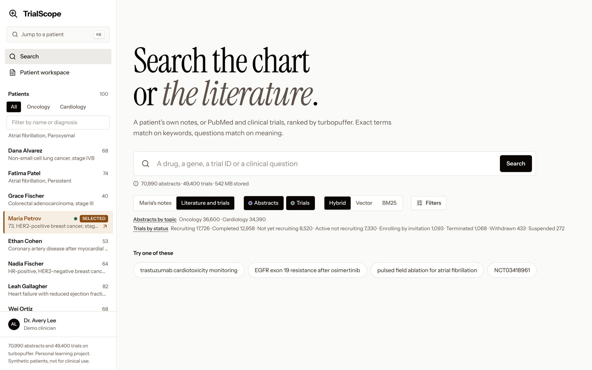
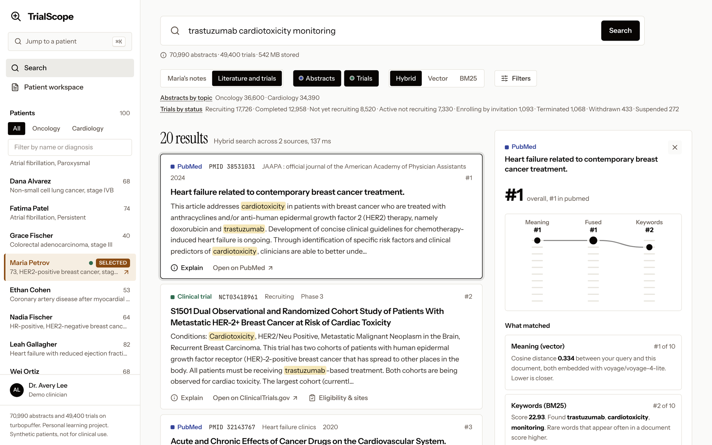
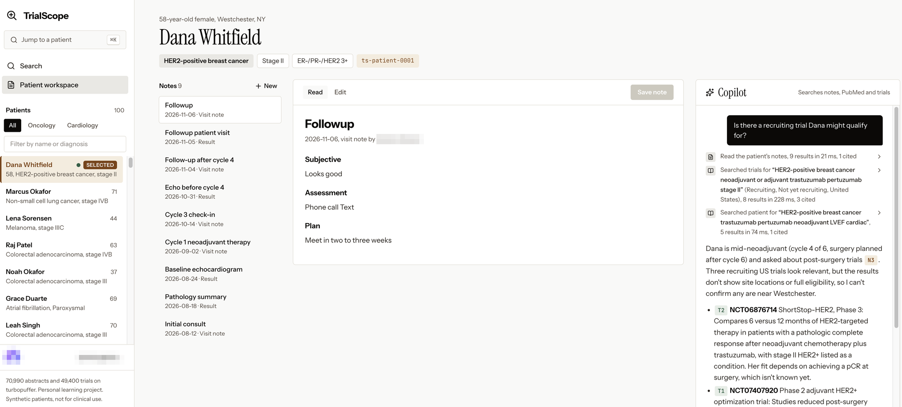
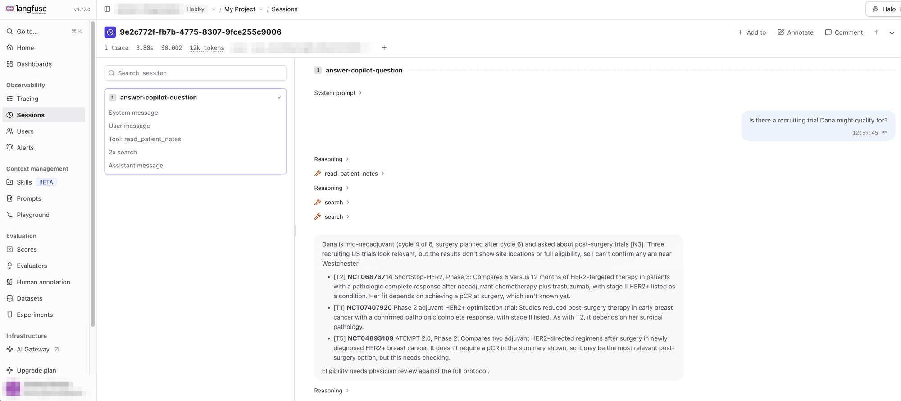

# TrialScope (web)

Search patient notes, PubMed abstracts and ClinicalTrials.gov records from one place, with a Claude
copilot that answers with citations. Everything is stored and searched in
[turbopuffer](https://turbopuffer.com). Built with Next.js, deployed on Vercel.

> **Personal learning project.** I built TrialScope on my own time to learn turbopuffer (hybrid
> search, native embedding, filtering and many-namespace multi-tenancy) and how an AI copilot can sit
> on top of a search layer. It is not affiliated with, sponsored by or endorsed by turbopuffer,
> Anthropic, Vercel, the NIH/NLM, ClinicalTrials.gov or any employer.
>
> **Not for clinical use.** Every patient and note is fictional, generated by a script. PubMed
> abstracts and trial records are public data shown for demonstration only and may be incomplete or
> out of date. Nothing here is medical advice.

This is the web version of the Streamlit app in
[jgerson/trialscope-demo](https://github.com/jgerson/trialscope-demo). Both read the same
turbopuffer namespaces, so no data needs loading here.

## Screenshots

**Search.** Pick the selected patient's notes, or any mix of PubMed abstracts and clinical trials, and a retrieval mode.
The line under the box and the counts below the controls come from turbopuffer aggregate queries and namespace metadata.



**Explain.** Every result shows why it ranked where it did: its rank by meaning and by keywords, how the two were
fused, the cosine distance, the BM25 score and the words that matched.



**Copilot.** Claude reads the patient's notes and searches trials through turbopuffer, then answers with citations
(`[N3]`, `[T1]`) that open the source. Each tool call is listed as a step and expands to show what it ran.



**Tracing.** The same question in Langfuse: the system prompt, Claude's reasoning, each tool call and the final
answer, with time, tokens and cost for the whole trace.



All patients are synthetic. Personal account details are blurred.

## Deploy to Vercel

1. Push this folder to a new GitHub repo.
2. In Vercel, choose **Add New → Project** and import the repo. The framework is detected as Next.js;
   keep the default build settings.
3. Under **Environment Variables**, add:

   | Name | Value |
   | --- | --- |
   | `TURBOPUFFER_API_KEY` | your turbopuffer key (required) |
   | `TURBOPUFFER_REGION` | `aws-us-east-1` |
   | `COPILOT_MODEL` | defaults to `anthropic/claude-sonnet-5.5` via AI Gateway (optional) |
   | `COPILOT_PROMPT_CACHE` | `true` turns on Anthropic prompt caching for the copilot (optional; off by default) |
   | `ANTHROPIC_API_KEY` | calls Anthropic directly instead of AI Gateway (optional) |
   | `READ_ONLY` | `true` blocks note edits (optional) |
   | `LANGFUSE_PUBLIC_KEY`, `LANGFUSE_SECRET_KEY` | turn on Langfuse tracing (optional; mark the secret key sensitive) |
   | `LANGFUSE_BASE_URL` | your Langfuse region, e.g. `https://us.cloud.langfuse.com` (with the keys) |
   | `LANGFUSE_TRACE_PAGE_LOADS` | `true` also sends page-load reads (patient list, notes list, row counts) to Langfuse (optional) |

4. Add **Clerk** from the Vercel Marketplace and connect it to the project. It adds
   `CLERK_SECRET_KEY` and `NEXT_PUBLIC_CLERK_PUBLISHABLE_KEY` for you. Who may sign up (open,
   invite-only or an email allowlist) is set in the Clerk dashboard.
5. Deploy. Changing a variable later needs a redeploy to take effect.

The copilot runs through [Vercel AI Gateway](https://vercel.com/docs/ai-gateway) and authenticates with the
project's OIDC token, so it needs no key on Vercel: AI Gateway just has to be enabled for the account.
Requests, spend and latency show up under **AI Gateway → Logs**. Locally, run `vercel link` then
`vercel env pull .env.local`, or set `AI_GATEWAY_API_KEY`.

Keys are only read on the server; none of them reach the browser.

### Logging every turbopuffer call

Every turbopuffer request goes through `tpCall` in `lib/tpuf-log.ts`, which writes one JSON line to the Vercel runtime
logs: `{"tpuf":"search", "namespace":"ts-pubmed", "ms":..., "networkMs":..., "serverMs":..., "embeddingMs":..., "cache":"hot",
"billedBytesQueried":..., "rows":[10,10], "top":[[id, score], ...], "request":{...}}`. Search the logs for `"tpuf"`.
Labels are `search`, `list-patients`, `list-notes`, `count-rows`, `namespace-metadata`, `facet-counts`,
`cache-check`, `hint-cache-warm`, `explain-query`, `consistency-strong` and `consistency-eventual`, and for a note save
`read-previous-note`, `write-note` and `wait-until-visible` (the visibility polling, logged once with its attempt count). Requests are logged
without `include_attributes`, written rows only as ids and text length, and results as ids and scores, never note text.
`networkMs` is `ms` minus turbopuffer's own `serverMs`: time on the network and in the client.
Errors are logged too (a 404 just means a patient has no notes yet). With Langfuse on, each line carries the `traceId`.
Vercel keeps runtime logs for an hour on Hobby and a day on Pro.

### Tracing with Langfuse (optional)

With the Langfuse keys set, every search, note save, copilot question and eligibility check is sent to
[Langfuse](https://langfuse.com) as one trace, and every turbopuffer call inside it appears as a `turbopuffer-<label>`
observation (a retriever for reads, a span for writes) with its request, timings, billed bytes and top results:

- **Search page** (`search-page`, tagged `search`): the query, sources, mode and filters, then one `turbopuffer-search` per
  namespace queried, and the merged top ten.
- **Note save** (`save-note`, tagged `notes`): `turbopuffer-read-previous-note`, `turbopuffer-write-note` and
  `turbopuffer-wait-until-visible`, with insert or update and where the time went.
- **Explain** (`explain-search`, tagged `explain`): `turbopuffer-explain-query` per subquery, then
  `turbopuffer-consistency-strong` and `turbopuffer-consistency-eventual`.
- **Copilot** (`answer-copilot-question`, an agent, tagged `copilot`): one `generate-response` generation per model
  turn with the full prompt it was sent (system prompt, tool definitions, earlier turns, tool results), the model's
  thinking summary and tool calls, tokens and cost; a `search-sources` or `read-patient-notes` tool observation for
  each tool call, with the filters turbopuffer applied. Questions in one copilot conversation share a session.
- **Eligibility** (`check-trial-eligibility`, tagged `eligibility`): `fetch-trial` and `read-patient-notes`, then the
  `assess-eligibility-criteria` generation.

Inside these traces you can also find:

- **Network spans.** Every outgoing HTTP call (turbopuffer, the model through AI Gateway or Anthropic, ClinicalTrials.gov)
  is an `http <METHOD> <host>` span under the step that made it, with path, status, time to response headers and
  sizes. Retries show as separate spans. Bodies, query strings and headers are never recorded. This is a custom `fetch`
  passed to the SDK clients (`lib/traced-fetch.ts`), so trace names and structure stay the same; outside a trace it's plain `fetch`.
- **Filterable turbopuffer details.** Each `turbopuffer-<label>` observation has flat metadata you can filter and chart
  on in Langfuse: `label`, `op`, `namespace`, `ms`, `serverMs`, `networkMs`, `embeddingMs`, `cache`, `rowsTotal`
  (`rowsVector`/`rowsBm25` for hybrid), `billedBytesQueried`, `billedBytesWritten` and `slow`. Calls of a second or more
  are marked level WARNING with a "slow turbopuffer call" message.
- **User feedback.** Thumbs up/down under each copilot answer posts to `/api/feedback`, which records a `user-feedback`
  score (BOOLEAN, 1 good, 0 bad) on that answer's trace through Langfuse's public scores API. Changing the vote replaces
  the score. The buttons only appear when tracing is on.

Traces carry the Clerk user id, the Vercel environment (`production`, `preview`, `development`) and the commit as
the release. Costs are AI Gateway list prices. The setup is in `lib/langfuse-setup.ts` and `lib/langfuse.ts`; without
the keys it does nothing.

## Walkthrough notebook

[`walkthrough/`](walkthrough/) is a ten-minute, self-contained notebook that shows the turbopuffer basics behind
the app on 8 real trials typed into it: loading with native embedding, keyword, vector and hybrid search, patient
filters and a namespace per patient. It creates its own namespaces for each run and never touches the app's data.
[Open it in Colab](https://colab.research.google.com/github/jgerson/trialscope-vercel/blob/main/walkthrough/trialscope_walkthrough.ipynb).

## Run locally

```bash
npm install
cp .env.example .env.local   # add your keys
npm run dev                  # http://localhost:3000
```

## What's inside

- **Search** (`/`): search either the selected patient's notes or PubMed abstracts, trials or both
  (never notes and literature at once). Every source and retrieval mode (hybrid, vector or BM25) has a tooltip
  saying where the data comes from or what the mode matches. The filters panel shows only the filters for the
  sources being searched: note type and visit date for notes; status, phase, country and patient age and sex for
  trials; year and topic for abstracts. Filters set for a source that's turned off are kept but don't
  apply, and the page says so. Links are shareable: `/?q=...&in=notes` or `&in=pubmed,trials`.
- **Corpus line**: under the search box, the size of each corpus two ways: an exact row count from an aggregate
  `Count` query, and stored bytes from the namespace's metadata, with the monthly storage cost at $0.33 per GB.
  Hover for how each number was fetched and how long it took. The numbers load after the page has rendered
  (`/api/corpus`), are cached for 10 minutes per server, and concurrent requests share one set of calls.
- **Facets**: counts per trial status, per topic for abstracts, or per note type, each from one
  aggregate query with `group_by` per namespace, shown for information. The source's other active filters apply;
  all filtering itself happens in the Filters panel.
- **Cache warm-up**: selecting a patient asks turbopuffer to warm their namespace (`hint_cache_warm`). A dot on the
  selected patient in the sidebar shows cold, warming or warm, read from a tiny count query's cache temperature
  (checked once on selection and once more a few seconds later).
- **Explain**: select any result to see its rank by meaning and by keywords, drawn as a small
  ladder, plus its cosine distance, BM25 score, matched words, the RRF arithmetic and how it merged
  with the other sources. With nothing selected, the panel shows how the search ran: parallel
  requests, server and embedding time, cache state and the exact request sent to turbopuffer. **Query plan and
  consistency** asks turbopuffer for its query plan (`explain_query`) for each subquery, and times the same request
  with strong and with eventual consistency (traced in Langfuse as `explain-search`).
- **Patient workspace** (`/patients/[id]`): notes list, a markdown editor with read and edit modes,
  and a save that reports how soon the note became searchable (usually tens of milliseconds).
  **Details** on a save opens "What the save did": insert or update and the diff, where the time went (network,
  turbopuffer's write, embedding, then until searchable, from turbopuffer's own write report), the row and how each
  field is stored, and a search that shows where the edited note now ranks.
- **Copilot**: Claude with two tools, `search` and `read_patient_notes`. Answers stream in, each turbopuffer call is
  listed as it happens, and `[N1]`, `[P1]`, `[T1]` tags open source cards.
  Each step expands to show the model's reasoning, the exact tool call, the filters turbopuffer actually applied,
  and every result returned, marked cited or not used, with **Why this result?** opening the ranking explainer.
  After the answer, a footer shows time, sources cited, tokens and approximate cost. With
  `COPILOT_PROMPT_CACHE=true`, each model call reads the previous call's prompt from Anthropic's prompt cache (automatic
  caching, 5-minute lifetime); cache reads and writes are priced separately, shown on hover and logged per turn. If the
  API ever rejects the cache setting, the copilot retries without it. Each question gets up to six model
  turns of up to 4,000 output tokens each, within the route's 300-second limit; if one of those limits stops an answer,
  a note under it says which.
- **Trial page** (`/trials/<NCT id>`, linked from trial results and copilot citations): reads the trial live from the
  ClinicalTrials.gov API, because the index keeps only the first 2,500 characters of eligibility criteria and no sites.
  - **Eligibility checklist**: one model call (`lib/eligibility.ts`) checks each criterion against the selected
    patient's record and notes. A *meets* or *doesn't meet* verdict must cite the record or a note, or it is shown as
    unknown.
  - **Sites near the patient**: recruiting sites sorted by distance from the patient's town, on an OpenStreetMap map.
    Patient towns map to coordinates in `lib/places.ts` (the generator's fixed list), so no geocoding service is used.
- **⌘K**: jump to any patient or search the corpus from anywhere.
- **Sign-in with Clerk**: every page and API route requires a signed-in user (`clerkMiddleware` in
  `proxy.ts`, plus a check in each API route). There is no sign-up page; accounts are created in Clerk's
  dashboard. In production, session tokens are accepted only for trialscope.space. New notes are credited to
  whoever wrote them.
- **Security and operations**: every response forbids framing by other sites and content-type guessing, uses a
  strict referrer policy, and turns off camera, microphone, location, payment and USB access (`next.config.ts`). The
  two production vercel.app addresses redirect to www.trialscope.space; branch previews keep their own addresses.
  Vercel Web Analytics counts page views.

## How search works

- Each document has one `text` attribute that is both BM25-indexed and natively embedded by
  turbopuffer (`voyage/voyage-4-lite`), so one attribute serves every mode.
- **Hybrid** sends one `multiQuery` with a vector subquery and a BM25 subquery, then fuses the two
  ranked lists with reciprocal rank fusion (k = 60, the same formula as turbopuffer's
  `rerank_by: ["RRF"]`), keeping each list's rank for the explainer.
- **Several sources** are queried in parallel and merged by rank.

## Data

All data lives in turbopuffer (`aws-us-east-1`) and is loaded by scripts in
[jgerson/trialscope-demo](https://github.com/jgerson/trialscope-demo).

| Namespace | Contents | Rows |
| --- | --- | --- |
| `ts-pubmed` | Oncology and cardiology abstracts, 2015 onward | 70,990 |
| `ts-trials` | Interventional studies, most recently updated first | 49,400 |
| `ts-patients` | Directory of synthetic patients | 100 |
| `ts-patient-0001` … `0100` | Chart notes, one namespace per patient | 447 seeded notes |

An earlier version also searched full-text articles, stored as passages in `ts-pmc`. That was removed to keep the
demo simple; the namespace is still in turbopuffer, but nothing reads it.

## Known limits

- Only abstracts are searched, so details that appear only in an article's body (methods, doses, thresholds) aren't found.
- Trial eligibility text in the index is cut at 2,500 characters; the trial page reads the full criteria live.
- Each patient has their own namespace, so a question across all patients needs one query per patient.

## Files

| Path | Job |
| --- | --- |
| `app/(app)/page.tsx` | Search page |
| `app/(app)/patients/[id]/page.tsx` | Patient workspace |
| `app/(app)/trials/[nct]/page.tsx` | Trial page: eligibility checklist and nearby sites |
| `app/sign-in/` | Clerk sign-in page (no sign-up page: accounts are created in Clerk's dashboard) |
| `app/api/search`, `api/notes`, `api/copilot`, `api/eligibility`, `api/feedback` | Server routes (the copilot streams NDJSON; feedback becomes a Langfuse score) |
| `lib/tpuf.ts` | turbopuffer: search modes, RRF, filters, notes, patients |
| `lib/tpuf-log.ts` | Logs every turbopuffer call to Vercel logs and Langfuse |
| `lib/copilot.ts` | Claude tool-use loop and citations |
| `lib/eligibility.ts`, `lib/ctgov.ts`, `lib/places.ts` | Eligibility checklist, live ClinicalTrials.gov reads, site distances |
| `lib/langfuse.ts`, `lib/langfuse-setup.ts`, `lib/traced-fetch.ts`, `instrumentation.ts` | Optional Langfuse tracing, including network spans |
| `components/` | App shell and ⌘K, search view, explain panel, workspace and save details, copilot, trial view and sites map, sign-in frame |
| `proxy.ts` | Clerk sign-in check before every request |
| `walkthrough/` | Ten-minute turbopuffer notebook (Colab) |

## Data sources

- Clinical trials: [ClinicalTrials.gov API v2](https://clinicaltrials.gov/data-api/api), U.S. National Library of Medicine.
- Abstracts: [PubMed via NCBI E-utilities](https://www.ncbi.nlm.nih.gov/books/NBK25501/), U.S. National Library of Medicine.
- Patients and notes: synthetic, generated by `ingest/patients.py` in the Streamlit repo.
